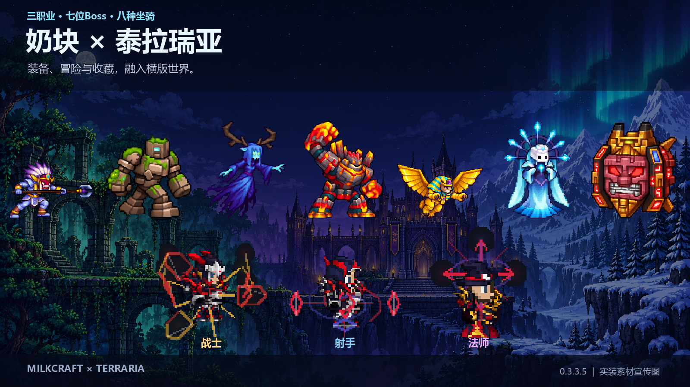
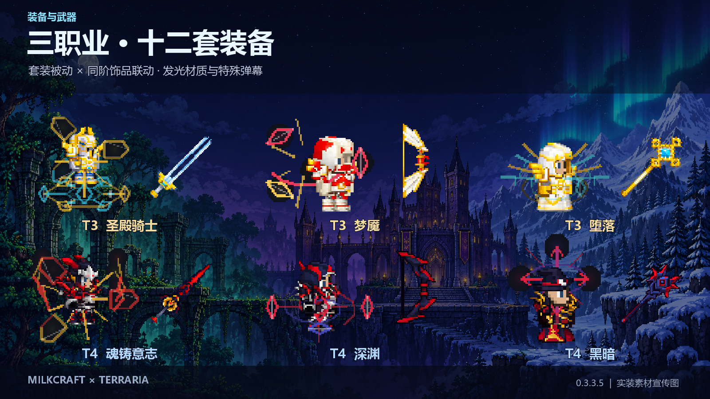
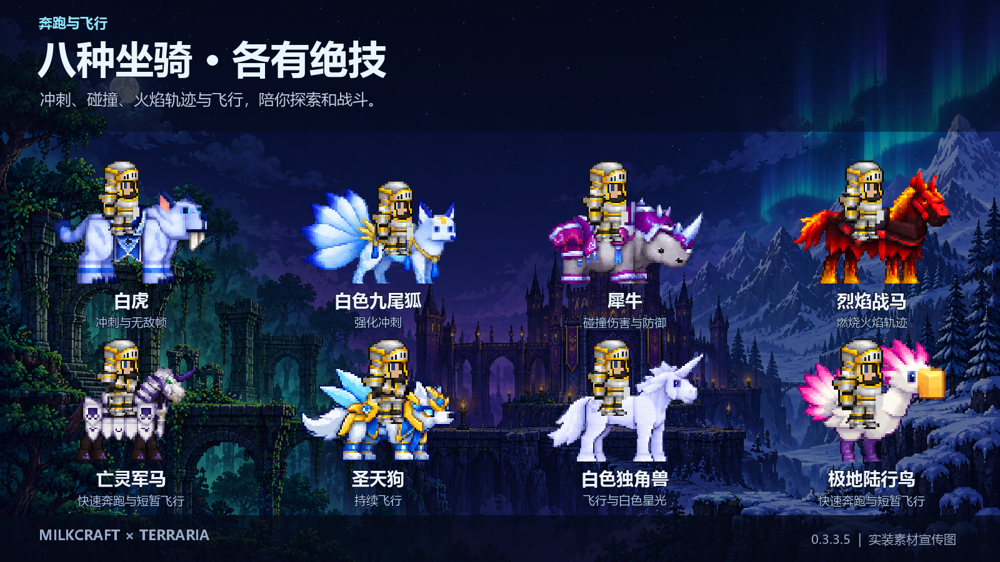

# 奶块 × 泰拉瑞亚

Milkcraft × Terraria 是 Terraria 1.4.4 的非官方 tModLoader 内容模组，提供三职业装备、武器、Boss、坐骑、宠物和制作系统。当前版本 **0.3.3.5**。

在 [Steam创意工坊](https://steamcommunity.com/sharedfiles/filedetails/?id=3816192019)订阅，或从 [GitHub Releases](https://github.com/JAYSAYlil/MilkcraftTerraria/releases/tag/v0.3.3.5)下载 `MilkcraftTerraria.tmod`。需要 Terraria 1.4.4 和 tModLoader stable；本版验证环境为 tModLoader 2026.8.3.0。

## 内容

- 战士、射手、法师，T1—T4共十二套护甲、十三种武器、十二件副手饰品；独立套装被动与同阶饰品联动。
- 七位Boss：怨灵武士、丛林领主、女妖、黑曜石守卫、斯芬克斯、冰霜女巫、城堡核心；阶段技能、援军、宝藏袋、面具、纪念章与大师遗物。
- 八种坐骑，七种Boss宠物，其中三种照明宠物。
- 黑铁矿、粉钻矿、七种工作站、六种特殊药水、阶段许可及十二种付费特殊附魔；支持合成物品的微光分解。
- 159种模组物品，100条模组产出配方和1条补充原版皮革配方。

宣传图由实装像素素材组合；场景背景为宣传插画。

## 指南

- [完整内容指南](docs/content-guide.md)：阶段、属性、套装被动、饰品、武器、附魔、Boss、坐骑、宠物和全部物品的获取方式。
- [全部配方](docs/recipes.md) · [机器可读配方](docs/recipes.json)
- [从源码构建](docs/build.md) · [验证范围](docs/validation.md)
- [更新日志](CHANGELOG.md) · [素材来源](CREDITS.md)

## 安装

创意工坊订阅后，在 tModLoader 的模组管理中启用。手动安装请通过 tModLoader 的“打开模组文件夹”放入 `.tmod` 后重新加载。源码包用于开发与构建，不是可直接订阅的成品。

模组制作与发布：JaySay。此项目与奶块原运营方无官方关系，原作设计与相关商标归各自权利人。
