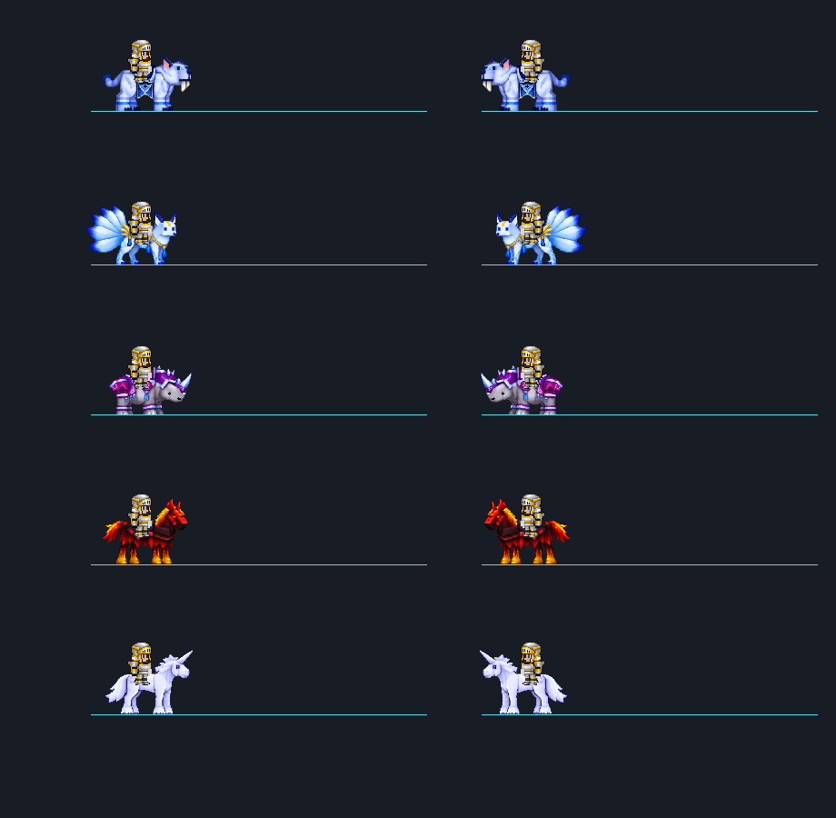
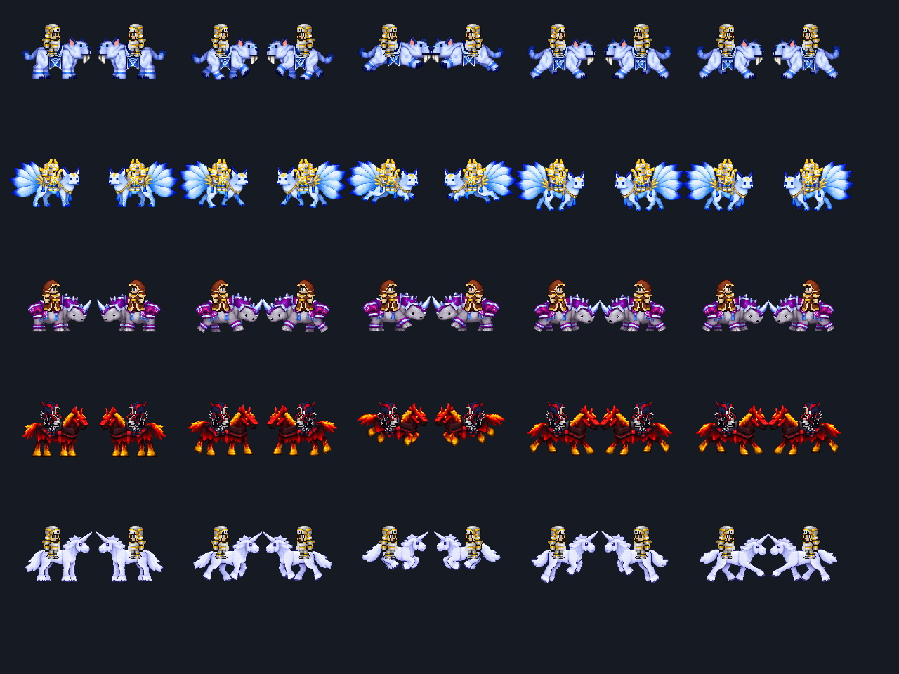
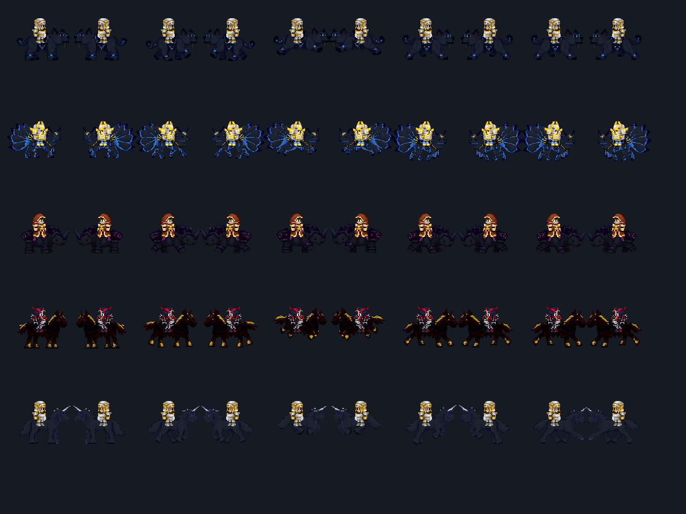

# 奶块 × 泰拉瑞亚 / Milkcraft × Terraria

将奶块经典装备与坐骑的视觉风格带入泰拉瑞亚，同时按泰拉瑞亚的战斗、制作和进度重新设计玩法。
当前版本 **0.2.13**，适配 **Terraria 1.4.4.9 / tModLoader 1.4.4 stable**；本次构建使用 tModLoader **2026.8.3.0**。

## 内容

- 战士、射手、法师三职业的 T1–T4 装备、剑、弓、法杖，以及盾牌、箭袋和法典。
- 完整套装独立提供被动奖励；对应饰品独立提供稳定收益，同阶同职业配对进一步强化套装效果。
- T1/T2 配对弓杖使用特殊弹射物；T3/T4 进一步获得自动追踪。武器弹幕、套装被动与局部发光材质保留各自配色。
- 七种制作工作站、黑铁矿石和粉钻矿、六种固定配方药水、Boss 材料掉落和永久穿戴许可。
- 十二种奶块特殊附魔，钱币付费、选定必成，与哥布林重铸词条独立叠加。
- 大粥的铁剑，月亮领主后的终局剑，攻击展示四把完整合成剑。
- 七种永久坐骑：亡灵军马、圣天狗、白虎、白色九尾狐、犀牛、烈焰战马、白色独角兽。
- 可合成物品使用原版配方微光分解；掉落材料不额外强制分解。

共 **112 件模组物品、94 条配方**（93 条模组产出配方及 1 条原版皮革补充配方）。没有其他模组前置。

## 安装

推荐在 tModLoader 创意工坊订阅，或从本仓库 Releases 下载 `MilkcraftTerraria.tmod`。
手动安装时，在 tModLoader 的模组菜单打开模组文件夹，将 `.tmod` 放入并启用，重新加载后进入世界。
仅支持 tModLoader，原版 Terraria 不直接加载 `.tmod`。

普通安装不会自动赠送测试装备或坐骑。无需重新创建角色；已有世界可通过原版 Boss 掉落获得升级材料、通过钓鱼匣获得白虎。新矿脉及白虎宝箱奖励只在新世界生成。

## 进度

| 等级 | 泰拉瑞亚阶段 | 升级方式 |
| --- | --- | --- |
| T1 | 困难模式前基础阶段 | 原版材料，在铁砧／铅砧制作 |
| T2 | 克苏鲁之脑／世界吞噬者之后 | Boss 必掉黑铁矿石与粉钻，专职工作站加工 |
| T3 | 机械三王阶段，神圣套附近 | 三王必掉真理材料和药水核心；收齐三职业材料制作永久许可 |
| T4 | 石巨人之后，甲虫／幽灵／蘑菇套附近 | 石巨人按战士→射手→法师循环，每次掉一组配对材料；制作永久许可 |
| 终局 | 月亮领主之后 | 四把模组剑与断掉的铁剑合成大粥的铁剑 |

炼金没有随机失败，核心材料固定掉落、加工批量产出。角色可以自由切换职业，适合单人游玩。

## 使用资料

- [全部物品、合成配方与取得方式](docs/recipes.md)
- [工作站、材料进度与附魔](docs/gameplay.md)
- [七种坐骑的获得方式与能力](docs/mounts.md)
- [微光分解](docs/shimmer.md)
- [0.2.13 发布说明](CHANGELOG.md)
- [素材来源与制作说明](CREDITS.md)
- [验证记录与范围](docs/validation.md)
- [从源码构建](docs/build.md)

## 预览

以下为实际 tModLoader 原生人物绘制器生成的骑乘预览，非概念图或人工世界截图。

## 项目与反馈

这是个人制作的非官方奶块题材模组。视觉素材依据公开图鉴、模型展示与游戏画面重建为二维像素素材，未从奶块客户端提取。
反馈问题时请附 tModLoader 版本、模组版本、复现步骤及相关日志；发布记录说明了自动测试覆盖和尚未进行的联机检查。
奶块、Terraria、tModLoader 及其原有名称和内容归各自权利人。本仓库不对第三方原始内容授予许可。
